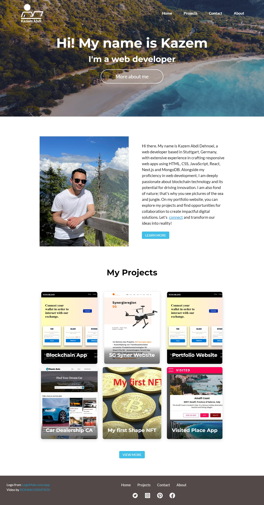

# Kazem Abdi – Portfolio

Personal portfolio of Kazem Abdi Dehnoei, a web developer based in Stuttgart, Germany.

**Live:** https://my-portfolio-website-nextjs.vercel.app/



## Features

- Home page with a video hero, about section, skills and featured projects
- Project gallery with a year/month filter (`/projects/2022/7`) and a statically generated detail page per project
- Light and dark mode (follows the system setting, with a toggle in the header)
- Contact form that sends email through [Resend](https://resend.com)
- Per-page SEO metadata, Open Graph tags, `sitemap.xml` and `robots.txt`
- Optimized images (`next/image`) and self-hosted fonts (`next/font`)

## Tech stack

Next.js 16 (Pages Router) · React 19 · TypeScript · CSS Modules · react-icons · ESLint · Prettier

## Getting started

```bash
npm install
npm run dev        # http://localhost:3000
```

Other scripts:

```bash
npm run build      # production build
npm run start      # serve the production build
npm run lint       # ESLint
npm run typecheck  # TypeScript
npm run format     # Prettier
```

### Contact form

Copy `.env.example` to `.env.local` and set `RESEND_API_KEY`. Without it the form shows a message asking visitors to email directly. To deliver to any address, verify a domain in Resend and set `CONTACT_FROM_EMAIL`. Add the same variables in the Vercel project settings for production.

## Adding a project

1. Put a screenshot in `public/images/`.
2. Add an entry to `PROJECTS` in [`data/projects.ts`](data/projects.ts) (import the image at the top of the file; use an ISO date like `2024-08-12`).
3. Set `isFeatured: true` to show it on the home page. New years appear in the filter automatically.

## Credits

- Logo: [LogoMakr](https://app.logomakr.com/)
- Hero video: [Roman Odintsov on Pexels](https://www.pexels.com/video/drone-shot-of-the-coast-6662984/)
